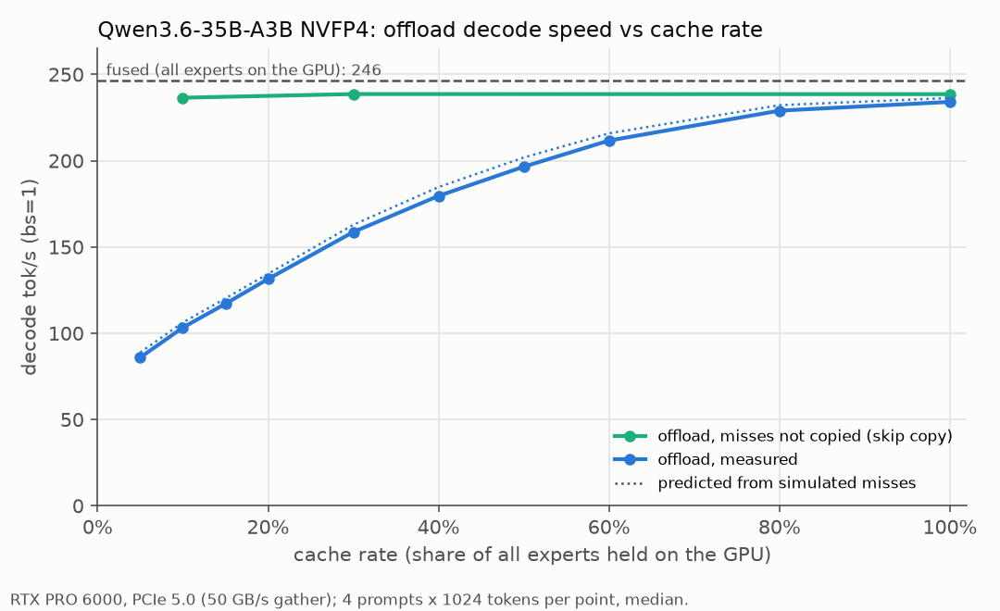
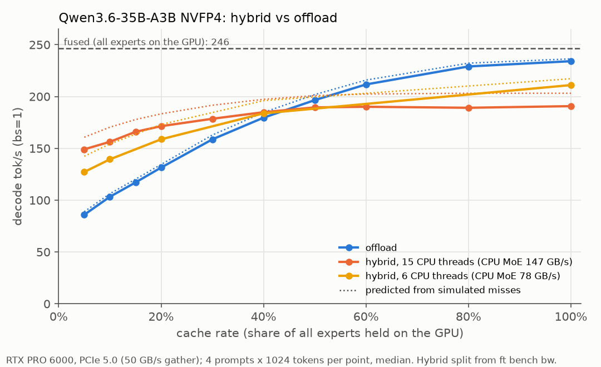
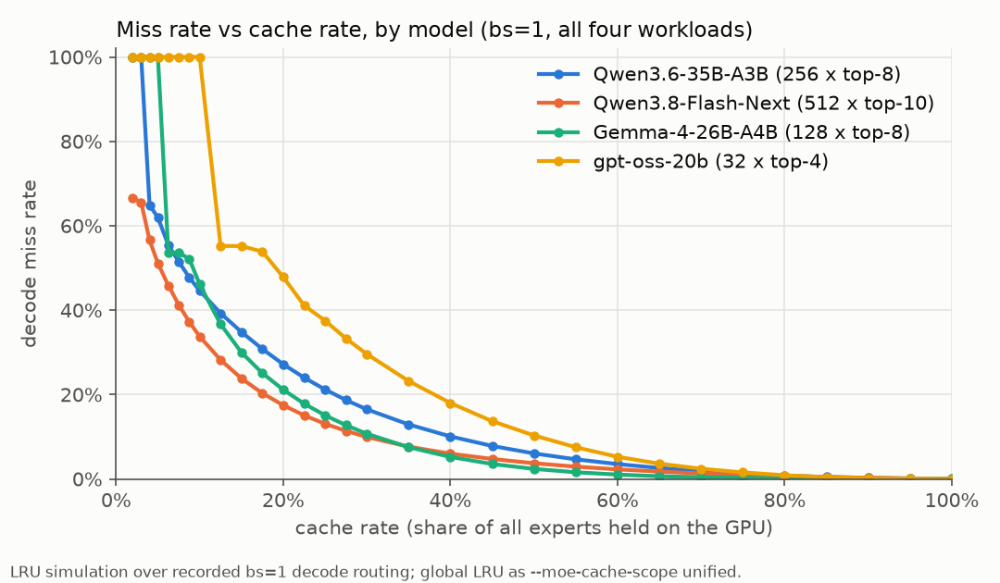
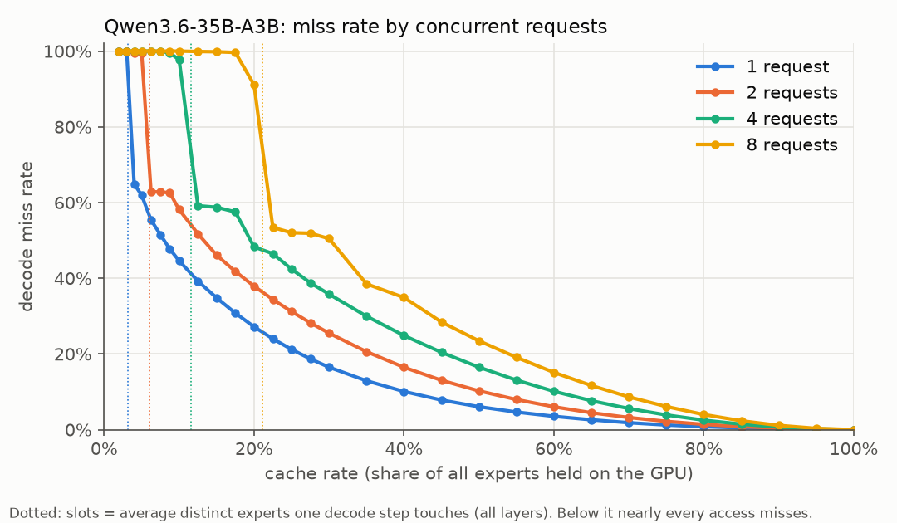
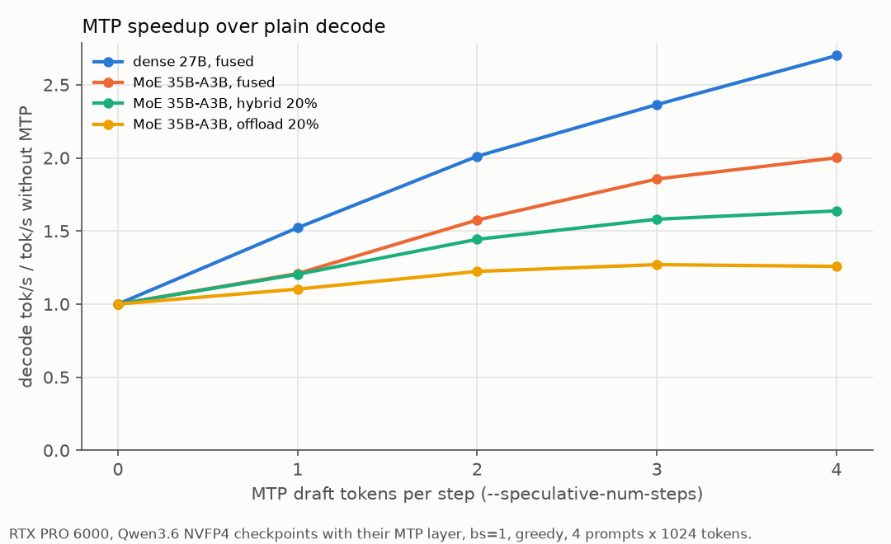

# Speeding up decode

Decode is memory-bound: each step reads the weights it needs once and does
little math with them. Speeding it up means reading fewer bytes, or reading
them from faster memory. With offloaded experts (`offload` and `hybrid`, see
[models.md](../models.md#moe-strategies)) that comes down to how often an
expert misses the GPU cache, and what a miss costs.

The numbers below come from one machine: RTX PRO 6000 (PCIe 5.0), 16-core
Xeon with 8-channel DDR5, Qwen3.6-35B-A3B NVFP4 (40 MoE layers, 256 experts,
top-8, 1.77 MB per expert), bs=1, greedy decoding of math and code prompts.
The [summary](#summary) at the end splits the fixes into flags and development.

## How a decode step spends its time

A decode step reads every dense weight, the experts its tokens route to, and
the KV cache.

- **Hit**: the expert is in the GPU cache and is read from VRAM.
- **Miss** (`offload`): the expert is first copied over PCIe at about 50 GB/s
  (`ft bench bw` measures it), about 30x slower per byte than VRAM. A layer
  knows its experts only after its router runs, so the copy cannot hide behind
  the layer's compute. Every miss adds to the step.

The **cache rate** (`--moe-cache-rate`) is the share of all experts the GPU
cache holds, one expert per slot. With `--moe-cache-auto` the startup log
prints `resolved moe_cache_size=N`; divide N by MoE layers x experts per layer.

So for `offload`:

```
step time ≈ t_hit + misses per step × bytes per expert / PCIe bandwidth
misses per step = miss rate × MoE layers × top_k          (bs=1)
```

`t_hit` is the step time when nothing misses. To measure it, serve with
`FREETOKEN_SKIP_FAST_INDEX_COPY=1`: misses are counted but not copied, so the
output is garbage. It is close to `fused` (4.19 vs 4.06 ms).

`--moe-collect-stats` logs the misses per MoE layer per step (layer-step):

```
MoE decode, pinned 40 layers: hit 71.0%, per layer-step miss 2.32 fetch 2.32 cpu 0.00
```

Example at a 20% cache: 2.32 misses per layer-step x 40 layers x 1.77 MB /
50.3 GB/s = 3.3 ms, plus `t_hit` 4.2 ms = 7.5 ms per step, 134 tok/s.
Measured: 131 tok/s. At every cache rate the estimate is within 3% of the
measurement (dotted: predicted from simulated misses):



## Hybrid: computing misses on the CPU

With `--moe-strategy hybrid`, each MoE layer copies a share `f` of its misses
over PCIe and computes them on the GPU. It computes the rest on the CPU,
straight from host RAM. Both run at once, and the layer waits for the slower
side. With PCIe bandwidth `p` and CPU bandwidth `c`, `f = p / (p + c)` makes
both finish together, so misses cost at best `bytes per expert / (p + c)`
instead of `/ p`.

`ft bench bw --model <checkpoint>` measures `p` and `c` for each MoE layer
kind, and `ft serve` derives the split from them. Run it once per GPU and
model, with `--cpu-threads` equal to the server's `--moe-cpu-threads`.
Without a matching row, the server warns
`no ft bench bw row ... using a fixed fetch cap of 1` and hybrid fetches at
most one expert per layer per step.

```
    format      expert       CPU-MoE   PCIe-gather  CPU/PCIe  backend
    nvfp4      1.70 MB    147.3 GB/s     50.3 GB/s     2.93x  hybrid
       overlapped: CPU-MoE 173.8 + PCIe 50.4 GB/s -> hybrid fetches 22.5% of misses
```

`c` is CPU-MoE and `p` is PCIe-gather. The split uses the `overlapped` pair,
measured while both run, because the PCIe copy also reads host RAM. That costs
nothing visible on this 8-channel server, but on a dual-channel desktop the
copy would take a large share of the CPU's bandwidth (not measured here).
The expert column is in MiB of the tool's bank layout, hence 1.70 rather than
1.77 MB.

Hybrid also pays twice for its CPU side:

- **CPU-computed experts are not cached**, so at the same cache size hybrid's
  hit rate is lower than offload's.
- **Every MoE layer makes a CPU round trip**, about 6 µs here (0.25 ms per
  step).

So hybrid wins when misses are many:



- Below about 40-50% of the experts cached, hybrid is faster (at 5%: 149 vs
  86 tok/s), even with 6 CPU threads, where `ft bench bw` recommends `offload`.
- Above that, `offload` is faster (at 100%: 234 vs 191 tok/s).

The dotted lines use the same formulas with simulated misses. The hybrid
formula, round trip included, came out up to 13% faster than the measured
steps (see [For developers](#for-developers-where-to-look)).

The crossover moves with the CPU-to-PCIe bandwidth ratio and the model, so on
another machine compare both strategies at your cache size.

## Miss rate vs cache rate

These curves replay recorded bs=1 decode routing through an LRU simulation of
the unified pool. The miss rate falls steeply with the first slots, then
slowly. It depends on the model and the workload: at a 20% cache, Qwen3.6
misses 22-33% across math, code, Chinese writing and an 8k code-agent context,
and Gemma 4 misses 12-26%.



**The cache must hold at least one step's experts.** All layers share one LRU
pool (`--moe-cache-scope unified`), and one step touches `top_k / num_experts`
of all experts (bs=1; 3.1% for Qwen3.6). Below that floor, every expert is
evicted before it is needed again, so every access misses. Qwen3.6 at 3%: hit
rate 0%, 63 tok/s; at 4%: 35%, 84 tok/s. gpt-oss-20b (top-4 of 32) needs at
least 12.5%.

**Above the floor the miss rate falls in steps.** A token shares some experts
with the previous token (35% for Qwen3.6). Once the pool holds one step's
experts, those hit, so the miss rate drops at once (to 65%). Each further step
of history the pool holds adds a smaller drop. With few experts per layer the
steps stay wide: gpt-oss-20b stays at 55% from 12.5% to 17.5%.

The server has its own minimum: two layers of experts with prefill overlap
(the default), one without. A smaller `--moe-cache-rate` or `--moe-cache-size`
fails at startup. For Qwen3.6 that is 5%, so the 3% and 4% runs need
`--disable-moe-prefill-overlap`.

**Concurrent requests raise the floor and the miss rate.** N requests use
almost N times as many experts per step, so the floor rises with them: 21% for
Qwen3.6 at 8 requests.



## Getting more slots

With `--moe-cache-auto` (the default), the expert cache gets what is left of
`--memory-ratio` x free VRAM after the weights, the fixed caches (the linear
attention state pool, MTP) and a KV reserve of `--kv-reserve-tokens` (8192).
Anything that shrinks those gives slots back, each at a price. Measured with
Qwen3.6 on the RTX PRO 6000 with all but 16 GiB of VRAM held by another
process (as on a 16 GB card; FreeToken saw 15.4 GiB free), where the defaults
give 5589 slots (55% of experts). The default count and the `--memory-ratio`
gain scale with free VRAM; the other rows do not:

| Option | Slots | Cost |
|---|---|---|
| `--max-running-requests 1` | +578 | one request at a time; the slots come from 16 fewer linear attention states (below) |
| `--embed-weights host` | +575 | each token reads its embedding row over PCIe (4 KB here); refused when the embedding is tied to the LM head |
| `--memory-ratio 0.95` | +460 | less headroom for CUDA graphs and prefill activations |
| `--text-model-only` | +95 | no image input (the vision tower already streams from host RAM by default) |
| `--kv-reserve-tokens 2048` | +70 | KV holds about 2.1k tokens in all, which is also the longest prompt + output (longer prompts are refused with `prompt is too long`) |
| `--speculative-algorithm mtp` | -983 | the draft layer and its caches take slots (MTP still ran about 1.4-1.5x faster here; see [Speculative decoding](#speculative-decoding)) |

- On models with linear attention (GDN) or sliding-window (SWA) layers, those
  layers keep no KV for the whole context: a GDN layer keeps one state per
  cached prefix point, a SWA layer keeps per-token KV only for the tokens inside
  its window, in a window pool of its own. The size of these pools decides how
  much of earlier prompts can be reused later, so it is a tradeoff of its own:
  more cached states mean more prefix reuse and fewer slots. One Qwen3.6 GDN
  state (all 30 GDN layers) is about 64 MB, the size of 36 expert slots.
  `ft ctl cache` shows the pools; `ft ctl cache --mamba N` sets the GDN pool to
  N states in all (24 by default, at least 4 per running request) and `--swa N`
  the window pool in tokens. A resize clears all cached prefixes and changes
  only the pools you name: to turn freed states into expert slots, raise
  `--moe` in the same call.
  `--cache-type naive` keeps no cached states at all, so it gives up prefix
  reuse entirely; it is not a way to buy slots.
- KV is cheap on this model (20 KB per token, so 8192 tokens are about 95
  slots) because most of its layers are linear attention. On a model with
  full attention in every layer, the KV reserve is worth many more slots. When
  the experts take everything else, the reserve is also the longest request:
  at the default 8192, prompt + output can be at most about 8.2k tokens here,
  and each extra 1k tokens of reserve costs about 12 slots.
- `--cuda-graph-max-bs` and `--max-prefill-length` use the headroom, not the
  budget, so they add no slots (`--cuda-graph-max-bs 1`: 5589 slots). Lower
  `--max-prefill-length` when a higher `--memory-ratio` makes prefill run out
  of memory (see [prefill.md](prefill.md#activation-memory)).
- With an explicit `--moe-cache-mem` / `--moe-cache-size`, KV gets what is
  left after the expert cache, with no `--kv-reserve-tokens` floor, so a larger
  cache shrinks KV and the longest request on its own (see the `Allocating N
  tokens for KV cache` startup line). `--num-tokens` only caps KV and adds no
  slots.
- A smaller expert format fits more experts and copies fewer bytes per miss
  (an NVFP4 expert is 56% the size of an FP8 one), at the cost of a different
  checkpoint with more coarsely quantized experts.

## For developers: where to look

An Nsight Systems trace of one decode step (`nsys profile -t cuda,nvtx
--cuda-graph-trace=node -o decode ft serve ...`) shows the GPU time and, with
`hybrid`, how long each layer waits for the CPU.

1. **Hybrid's CPU round trip.** Every layer pays it on every step, misses or
   not. To measure it, compare hybrid and offload with every expert cached and
   `FREETOKEN_HYBRID_FETCH_ROUND=prefer-fetch` (so the cache fills and the CPU
   computes almost nothing).
2. **CPU throughput at small batches.** In decode each layer hands the CPU
   only a few experts (1-5 here). Estimated from the hybrid step times with the
   formula above, the CPU side reached about 75% of the overlapped CPU-MoE
   bandwidth `ft bench bw` reports.
3. **The hybrid fetch count.** `f x misses` is rounded per layer
   (`FREETOKEN_HYBRID_FETCH_ROUND`). The default `min-wait` minimizes the
   current step, so a layer with fewer than 4 misses fetches nothing (at
   f = 0.225), and a large cache never fills: at 100% the hit rate stays at
   82%. `stochastic` came within 2.2% of the best mode at every cache rate
   here; `min-wait` was up to 13% behind.
4. **GPU bandwidth.** Divide the bytes a step reads by its GPU time in the
   trace and compare with the card's achievable read bandwidth. Close to it,
   only fewer bytes help (quantize the dense layers); far from it, the kernels
   need work.

## Speculative decoding

`--speculative-algorithm mtp --speculative-num-steps k` drafts `k` tokens
with the checkpoint's multi-token-prediction layer, and the next step verifies
them together with the regular token (see
[cli.md](../cli.md#speculative-decoding) for which models and setups support it).

**Why it helps.** A step that verifies `k + 1` tokens reads nearly the same
weights as a step for one token, so it costs much less than `k + 1` plain
steps. Qwen3.6-27B (dense) at `k = 4`: a step takes 1.46x as long, drafting
included, and yields 3.9 tokens.

**Why MoE gains less.** Its verify step costs more relative to a plain step:

- Its plain step is short (4.0 ms vs 14.8 ms for the 27B), so the draft passes
  and the extra tokens to verify weigh more.
- A verify step reads the union of the `k + 1` tokens' experts: 4 consecutive
  tokens of one request touch 2.3-2.75x the experts of one token (four MoE
  models). With `offload` and a small cache, those are extra misses, and they
  dominate (35B-A3B at a 20% cache: 2.3 misses per layer-step without MTP,
  10.5 at `k = 4`).



Tokens per step is the regular token plus the accepted drafts, at most `k + 1`
(the server logs it as `accept len`).

| Qwen3.6, bs=1, `k = 4` | tokens per step | speedup |
|---|---|---|
| 27B dense, `fused` | 3.9 | 2.70x |
| 35B-A3B MoE, `fused` | 3.85 | 2.00x |
| 35B-A3B MoE, `offload`, 50% cache | 3.85 | 1.64x |
| 35B-A3B MoE, `hybrid`, 20% cache | 3.8 | 1.64x |
| 35B-A3B MoE, `offload`, 20% cache | 3.85 | 1.26x |

Tokens per step depends on the content: at `k = 4` it ranged 3.1-4.3 per
prompt here (greedy), and text the draft predicts less well, or sampling, gets
fewer. With `offload`, drafts past 3 per step stopped paying off (at 20% and
50% cache); `hybrid` at 20% still gained at `k = 4`.

## Summary

| Situation | With flags | Needs development |
|---|---|---|
| Low hit rate | more slots; `hybrid` if the cache is small (compare both) | — |
| Cache below one step's experts | more slots, fewer running requests | — |
| Large cache, `hybrid` slower than `offload` | `--moe-strategy offload` | fetch-count rounding |
| Hybrid CPU side slow | keep the default `--moe-cpu-threads`; bench with `ft bench bw --model` at the same thread count | round trip per layer, small-batch CPU kernels |
| GPU-bound (high hit rate) | `fused` if the experts fit | fewer bytes (quantized dense layers), kernel bandwidth |
| MTP gains little with `offload` on a small cache | `--moe-strategy hybrid`; keep `--speculative-num-steps` at its default 3 | — |
